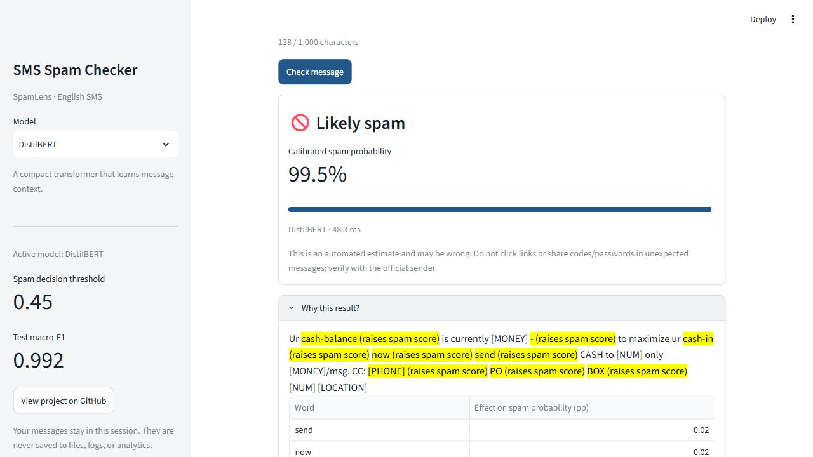
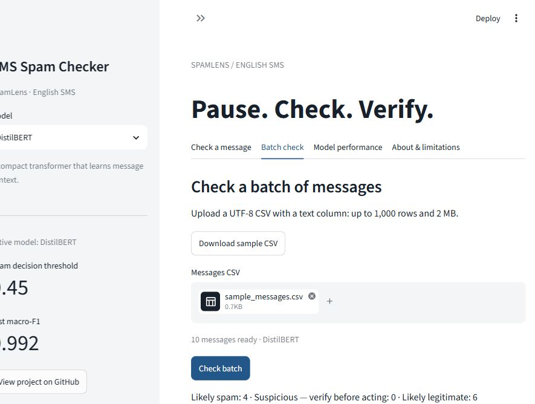
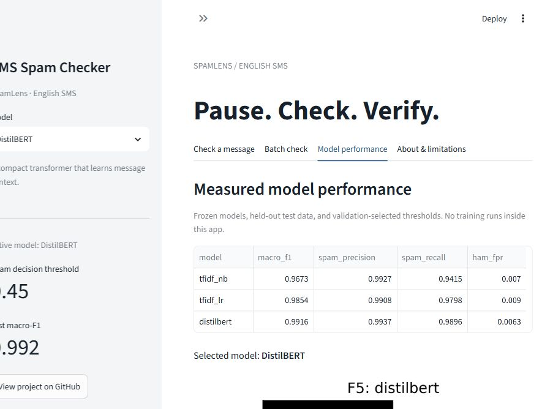

# SpamLens

English SMS spam classification with artefact-aware data curation, classical
baselines, and fine-tuned DistilBERT. The implementation follows
[docs/EXECUTION_GUIDE.md](docs/EXECUTION_GUIDE.md).

## Current status

The data pipeline, three trained models, validation-only calibration, E1–E8,
human-reviewed error taxonomy, and Streamlit application are implemented.
The pinned dataset rebuild matches the reference SHA-256 exactly. The app supports
single-message checks, batch CSV, explanations, performance, and a model selector.

See [implementation status](docs/IMPLEMENTATION_STATUS.md),
[dataset card](docs/DATA_CARD.md), and [model card](models/MODEL_CARD.md).
Development uses one branch, `main`, in [DlegendZ/SpamLens](https://github.com/DlegendZ/SpamLens).
**Public app URL: pending model publication and app deployment.**

## Measured results

These values come from `reports/tables/T4_main_results.csv` and
`reports/tables/T5_natural_prevalence.csv`, not the planning guide.

<!-- BEGIN GENERATED RESULTS -->
| Model | Test macro-F1 | Ham FPR | Spam precision at 13.4% prevalence |
|---|---:|---:|---:|
| M1: TF-IDF + Naive Bayes | 0.9673 | 0.70% | 94.61% |
| M2: Word + char TF-IDF + Logistic Regression | 0.9854 | 0.90% | 95.71% |
| M3: DistilBERT | 0.9916 | 0.63% | 96.27% |
<!-- END GENERATED RESULTS -->

Model comparison includes 1,000 seeded bootstrap resamples and exact paired
McNemar tests. SC1–SC6 pass. Automated tests and the local app pass; the public
deployment part of SC7 is pending.

## Run the app (PowerShell, Python 3.12)

From a checkout of `main`, create a separate app environment.
No datasets or training dependencies are needed. Requirements pin the exact
scikit-learn version that saved the committed classical artifacts.

```powershell
python -m venv .venv-app
.\.venv-app\Scripts\python.exe -m pip install -r requirements.txt
.\.venv-app\Scripts\python.exe -m streamlit run app\streamlit_app.py --server.port 8502
```

Open [http://localhost:8502](http://localhost:8502). In the existing training
environment, use `.\.venv\Scripts\python.exe -m streamlit run app\streamlit_app.py --server.port 8502`.

DistilBERT is selected by default. Its local weights are excluded from Git. A fresh
checkout uses M2 automatically and shows the fallback notice. To use M3 locally,
train it with the pipeline below; future Hub publication is pending T17.

On Linux, replace `.venv-app\Scripts\python.exe` with `.venv-app/bin/python`.
Input/upload results stay in memory; recent checks and explanation caches belong
only to your browser session. No SMS content is saved to disk, logs, or analytics.

## Screenshots (verified local run)





The 375 px layout capture is in `reports/screenshots/mobile_375px.jpg`.

## Training and tests

Keep GPU training separate from the app's CPU environment. Use Python 3.12, then
install the CUDA PyTorch build compatible with your driver using the
[official selector](https://pytorch.org/get-started/locally/) before training dependencies:

```powershell
python -m venv .venv
.\.venv\Scripts\python.exe -m pip install -r requirements-train.txt
.\.venv\Scripts\python.exe -m pip install -e .
.\.venv\Scripts\ruff.exe check .
.\.venv\Scripts\python.exe -m pytest -q
```

Measured test evidence is in `reports/metrics/test_summary.json` and
`reports/metrics/test_results.xml`. Tests marked slow use local M3 weights.

## Run the implemented pipeline

```powershell
.\.venv\Scripts\python.exe scripts\00_environment.py --require-cuda
.\.venv\Scripts\python.exe scripts\01_download_data.py
.\.venv\Scripts\python.exe scripts\02_build_dataset.py
.\.venv\Scripts\python.exe scripts\03_audit_dataset.py
.\.venv\Scripts\python.exe scripts\03_document_data.py
.\.venv\Scripts\python.exe scripts\04_eda.py
.\.venv\Scripts\python.exe scripts\05_train_classical.py
.\.venv\Scripts\python.exe scripts\06_train_distilbert.py
.\.venv\Scripts\python.exe scripts\07_calibrate.py
.\.venv\Scripts\python.exe scripts\12_verify_predictors.py
.\.venv\Scripts\python.exe scripts\08_evaluate.py
.\.venv\Scripts\python.exe scripts\12_validate_runtime.py
```

For E4, install `en_core_web_sm` with `python -m spacy download en_core_web_sm`
and NLTK resources with `python -c "import nltk; nltk.download('stopwords')"`
inside the venv. Local training logs record Python 3.12.8 and CUDA PyTorch
2.6.0+cu124; library versions are in `reports/metrics/environment.json`.

The team has completed T14 in this checkout. After a new evaluation run, preserve
or fill the private annotations and finalize the review:

```powershell
.\.venv\Scripts\python.exe scripts\10_finalize_error_analysis.py
```

Raw/processed datasets and transformer weights stay outside Git. The project owner
authorized merging and pushing the implementation to `main` on 2026-10-13.
Hugging Face model publication and Streamlit Cloud deployment remain separate tasks.

The six team identities are recorded in `docs/contribution_log.md`. Roles remain
blank at the project owner's request. Attribution is in [DATA_LICENSES.md](DATA_LICENSES.md).
